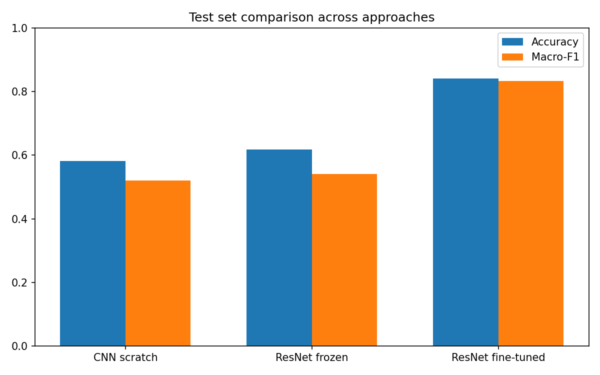
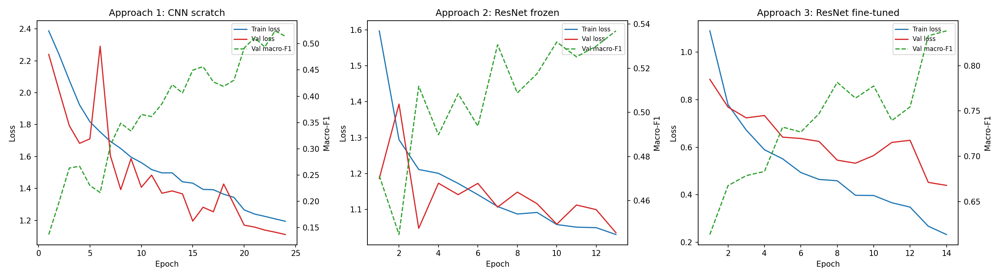
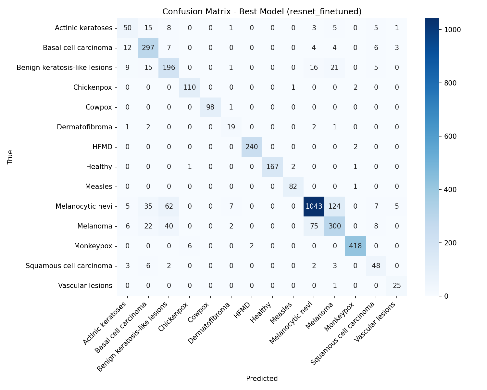
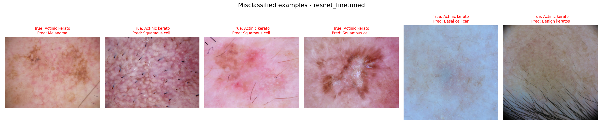

# Skin Lesion and Viral Disease Classification using Deep Learning

## Author
**Sokha Marady**  
Batch 13 Software Engineering | Deep Learning Final Project  
Lecturer: Mr. Soklong HIM | Academic Year: 2026 – 2027

## Problem Statement
**Task:** multi-class image classification. **Input:** a photo of a skin lesion or skin disease (RGB image, resized to 224x224). **Output:** one of 14 diagnostic classes.

Automated classification of skin lesions and viral skin diseases can support clinical triage, especially where dermatology specialists are scarce. A model could flag potentially malignant lesions (e.g., Melanoma, Basal cell carcinoma) or infectious diseases (e.g., Monkeypox, Chickenpox) for urgent review. This is an unusually broad task: it mixes skin cancers, benign growths, viral infections and a Healthy baseline.

## Dataset
**Source:** Skin Lesions Classification Dataset (Kaggle: `ahmedxc4/skin-ds`)  
**License:** CC0: Public Domain  
**Size:** 36,656 images across 14 classes.

The dataset aggregates the ISIC 2019 challenge data (HAM10000, BCN20000, MSK) and additional viral skin disease datasets (Monkeypox, Chickenpox, Measles, Cowpox, HFMD, Healthy).

**Classes (14):** Actinic keratoses, Basal cell carcinoma, Benign keratosis-like lesions, Chickenpox, Cowpox, Dermatofibroma, HFMD, Healthy, Measles, Melanocytic nevi, Melanoma, Monkeypox, Squamous cell carcinoma, Vascular lesions.

### Data Split
The dataset ships with an **official train/val/test split** as folders (`train/`, `val/`, `test/`, one sub-folder per class). The code reads these folders directly with torchvision `ImageFolder`.

| Split | Images |
| :--- | :--- |
| Train | 29,322 |
| Validation | 3,660 |
| Test | 3,674 |

All three approaches use the **identical split** and the **identical test-time preprocessing** (resize to 224x224, ImageNet mean/std normalization), so the comparison is fair. The test set was never used for training or model selection.

### Class Distribution & Known Bias
The dataset is heavily imbalanced.
* **Majority class:** Melanocytic nevi (10,300 training images)
* **Minority class:** Dermatofibroma (191 training images)
* **Imbalance ratio:** about 53.9:1

To compensate, a **weighted cross-entropy loss** is used, with class weights inversely proportional to class frequency in the training set.

## Approaches Compared
Three distinct approaches (they differ in architecture and/or training strategy):

1. **Approach 1: Custom CNN from scratch.** A 4-block Conv-BN-ReLU-Pool network trained from random initialization (392,974 trainable parameters). It sets a capacity floor for the problem.
2. **Approach 2: ResNet-18, frozen backbone (linear probe).** ImageNet-pretrained ResNet-18 with the convolutional backbone frozen. Only the final fully connected layer is trained (7,182 trainable parameters).
3. **Approach 3: ResNet-18, fully fine-tuned.** ImageNet-pretrained ResNet-18 with all layers trained end-to-end at a lower learning rate (11,183,694 trainable parameters).

## Experimental Setup
* **Framework:** PyTorch (strictly)
* **Optimizer:** Adam, with a ReduceLROnPlateau learning-rate scheduler
* **Batch size / input size:** 32 / 224x224
* **Loss:** weighted cross-entropy
* **Random seed:** 42 (Python, NumPy and PyTorch are all seeded)
* **Checkpointing:** `torch.save` / `torch.load`; the best checkpoint is chosen by lowest validation loss
* **Hardware:** Tesla T4 GPU (Google Colab)

| Approach | Learning rate | Weight decay | Epochs |
| :--- | :--- | :--- | :--- |
| 1. CNN scratch | 1e-3 | 1e-4 | 25 |
| 2. ResNet-18 frozen | 1e-3 | 1e-4 | 15 |
| 3. ResNet-18 fine-tuned | 1e-4 | 1e-4 | 15 |

## Results Summary
All numbers are on the same held-out test set (3,674 images).

| Approach | Test Acc | Macro-F1 | Macro-Precision | Macro-Recall | Trainable Params | Training Time (min) | Hardware |
| :--- | :--- | :--- | :--- | :--- | :--- | :--- | :--- |
| 1. CNN scratch | 0.5822 | 0.5205 | 0.5053 | 0.6123 | 392,974 | 160.6 | Tesla T4 |
| 2. ResNet-18 frozen | 0.6184 | 0.5415 | 0.5179 | 0.6074 | 7,182 | 98.0 | Tesla T4 |
| 3. ResNet-18 fine-tuned | **0.8419** | **0.8330** | 0.8117 | 0.8607 | 11,183,694 | 99.9 | Tesla T4 |

Macro-F1 is the main metric because the classes are heavily imbalanced; plain accuracy would favor the large classes.

### Comparison Figures
**Approach comparison**



**Learning curves (train vs. validation)**



**Confusion matrix (fine-tuned ResNet-18)**



**Misclassified examples**



### Hyperparameter Tuning
Tuned on the best approach (fine-tuned ResNet-18), 3 epochs per configuration, scored by validation macro-F1. Saved in `results/hyperparameter_tuning.csv`.

| Learning rate | Weight decay | Val Macro-F1 |
| :--- | :--- | :--- |
| **1e-4** | **1e-4** | **0.722 (best, used for final training)** |
| 1e-4 | 0.0 | 0.697 |
| 1e-5 | 1e-4 | 0.650 |

## Discussion & Error Analysis
**Why fine-tuning won.** The frozen ResNet-18 (Macro-F1 0.54) barely beat the scratch CNN (0.52), while full fine-tuning reached 0.83. ImageNet features alone transfer poorly to dermatology images because of the domain gap (natural objects vs. skin textures). Unfreezing lets the network adapt its features to the task, and pretraining gives it a far better starting point than random initialization. The scratch CNN is limited by capacity and by the amount of data.

**Per-class errors (fine-tuned model).** Viral and healthy classes are easy and distinct (Cowpox, HFMD, Healthy, Monkeypox, Measles all F1 ≥ 0.98; Chickenpox 0.96). The weak classes are visually similar and have few samples: Actinic keratoses (0.57), Melanoma (0.66), Squamous cell carcinoma (0.67), Dermatofibroma (0.68) and Benign keratosis-like lesions (0.68). These share similar colors, textures and borders, and even with weighted loss there are too few training samples to learn clean decision boundaries. See the confusion matrix and misclassified examples above.

**Extra finding: ensembling.** Averaging the probabilities of all three models did not help. The weak CNN diluted the strong fine-tuned model (on one test image: fine-tuned alone 99.62%, ensemble 56.68%). Ensembling works best when the models have similar skill; here their Macro-F1 values were 0.52, 0.54 and 0.83.

**Demo extra (not part of the official results).** The Gradio demo uses flip test-time augmentation (the normal image and its mirror image, with probabilities averaged). It was not applied to the official test results, so the comparison stays fair.

## Limitations & Future Work
* **Domain shift:** the model is trained on one dataset's photo style. It performs poorly on random internet photos with different lighting, camera or framing (e.g., a Vascular lesion photo was misclassified as HFMD with high confidence). For demos, use images from the dataset's test set.
* **Rare-class weakness:** low recall on rare, visually subtle cancers and pre-cancers is a clinical safety concern.
* **Multi-source acquisition bias:** images come from different sources with different resolutions and styles (HAM10000, BCN20000, MSK, viral datasets).
* **Not a medical device:** this is a course project and must not be used for diagnosis.
* **Future work:** targeted augmentation (CutMix/MixUp) or synthetic data for minority classes, Focal Loss, longer training, larger backbones, and training on more varied photo sources.

## Repository Structure
```
notebooks/   master_project.ipynb  (data prep, training of all 3 approaches, tuning, evaluation)
src/         test_model.py (standalone checkpoint test), app.py (Gradio demo),
             test_ensemble.py, test_model_tta.py
results/     metrics.csv, hyperparameter_tuning.csv, classification report, figures/
slides/      presentation
```

## How to Install and Run

### 1. Setup
```bash
git clone https://github.com/Smarady67/skin-lesion-classification.git
cd skin-lesion-classification
pip install -r requirements.txt
```

### 2. Train and evaluate all approaches (Google Colab, GPU)
1. Open `notebooks/master_project.ipynb` in Google Colab and select a GPU runtime.
2. In the Kaggle cell, enter your own Kaggle username and API key (placeholders are in the notebook).
3. Run the cells in order. The notebook downloads the dataset, trains the three approaches, runs the tuning sweep, saves checkpoints and writes the results and figures.

### 3. Test a trained model locally (outside Colab)
Download the fine-tuned checkpoint and place it at `results/checkpoints/resnet_finetuned_best.pth`:

**Model weights (134 MB, too large for GitHub):** https://drive.google.com/file/d/1HiLTkLZAE2DDiKOJbMNi2gTtT2qbfCBI/view?usp=sharing
Then set `IMAGE_PATH` in the script and run:
```bash
python src/test_model.py
```

### 4. Run the Gradio demo
```bash
python src/app.py
```
Open `http://127.0.0.1:7860`, upload an image and see the top-3 predictions.

## Citations
* **Dataset:** Skin Lesions Classification Dataset, Kaggle `ahmedxc4/skin-ds` (CC0). Built from ISIC 2019 (HAM10000, BCN20000, MSK) and public viral skin disease datasets.
* **ResNet:** K. He, X. Zhang, S. Ren, J. Sun, "Deep Residual Learning for Image Recognition," CVPR 2016.
* **Pre-trained weights:** torchvision ResNet-18 ImageNet weights (PyTorch / torchvision).
* **Libraries:** PyTorch, torchvision, scikit-learn, pandas, matplotlib, seaborn, Gradio.

## AI Use Disclosure
* **Tools used:** Claude (Anthropic).
* **Scope of use:** help with structuring code, debugging (e.g., checkpoint loading, Drive mounting), writing the local test script and Gradio demo, and drafting README text.
* **Verification:** I ran and checked all code and results myself, the reported numbers come from my own training runs and test-set evaluation, and I can explain and modify any code in this repository.